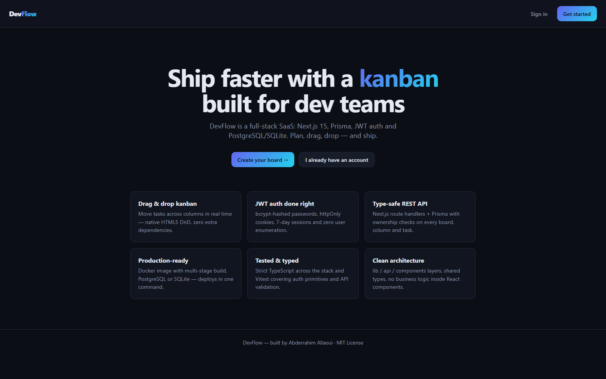
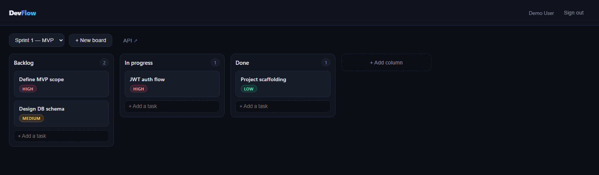
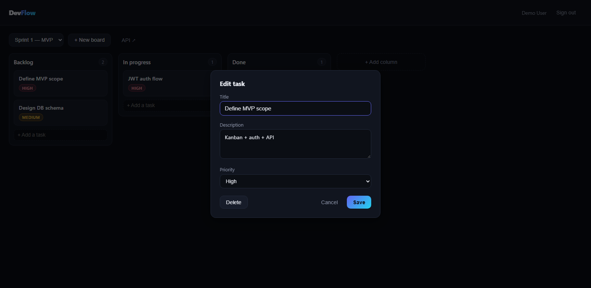

<div align="center">

# ⚡ DevFlow

**Full-stack kanban SaaS — plan it, drag it, ship it.**

[](LICENSE)
[](https://devflow-black-eight.vercel.app)
[](https://github.com/Abderrahim-Allaoui/devflow/actions/workflows/ci.yml)
[](https://nextjs.org)
[](https://www.prisma.io)
[](https://www.typescriptlang.org)
[](https://vitest.dev)

*A clean, production-ready reference project: REST API, JWT auth, drag & drop, Docker.*

> 🛒 **Using DevFlow in a client or paid product?** A commercial license of the
> template is available → [devflow-license.vercel.app](https://devflow-license.vercel.app)
> (Personal · Commercial · Studio — one-time payment, docs included).

[English](#-features) · [Français](#-en-français) · [API](#-rest-api) · [Quick start](#-quick-start)

</div>

---

## 📸 Screenshots

<p align="center">
  
</p>

<p align="center">
  
</p>

<p align="center">
  
</p>

---

## ✨ Features

- 🗂️ **Kanban boards** — columns & tasks with **HTML5 drag & drop** (zero DnD libraries)
- 🔐 **Auth** — register/login with **bcrypt** hashing and **JWT in httpOnly cookies** (7-day sessions)
- 🧱 **Typed REST API** — Next.js route handlers + Prisma, with **ownership checks** on every resource
- 🐘 **PostgreSQL or SQLite** — SQLite by default (zero setup), one-line switch to Postgres
- 🐳 **Docker** — multi-stage Dockerfile + compose stack (app + db)
- ✅ **Tested** — Vitest covering auth primitives and API validation, strict TypeScript everywhere
- 🌗 **Dark UI by design** — hand-rolled CSS design system, no UI framework tax
## 🛠️ Tech stack

| Layer | Choice |
| --- | --- |
| Frontend | Next.js 15 (App Router), React 19, TypeScript |
| API | Next.js Route Handlers (REST), httpOnly cookie sessions |
| Database | Prisma ORM — SQLite (default) / PostgreSQL |
| Auth | bcryptjs + jsonwebtoken |
| Tests | Vitest |
| DevOps | Docker, multi-stage build |

## 🚀 Quick start

### 1. Local (SQLite — no setup needed)

```bash
git clone https://github.com/Abderrahim-Allaoui/devflow.git
cd devflow
cp .env.example .env          # or just create .env (SQLite works out of the box)
npm install
npm run setup                 # prisma generate + db push + seed demo data
npm run dev                   # → http://localhost:3000
```

Demo account (after seeding): **demo@devflow.app** / **devflow123**

### 2. Docker (PostgreSQL)

```bash
# 1. switch provider: prisma/schema.prisma → provider = "postgresql"
# 2. set DATABASE_URL in .env (see docker-compose.yml)
docker compose up --build     # → http://localhost:3000
```

### 3. Production (Vercel + Neon) — the live demo

The live deployment runs on **Vercel** with a managed **PostgreSQL (Neon)** database.

- `prisma/schema.prisma` → SQLite, local dev (zero setup)
- `prisma/schema.postgres.prisma` → PostgreSQL, production

```bash
npx prisma generate --schema prisma/schema.postgres.prisma
npx prisma db push     --schema prisma/schema.postgres.prisma
npm run build:vercel   # generates the Postgres client, then builds
```

Environment variables expected on the host: `DATABASE_URL`, `JWT_SECRET`, `COOKIE_SECURE=true`.

**Live demo → https://devflow-black-eight.vercel.app**

### Tests

```bash
npm test          # vitest run
npm run typecheck # tsc --noEmit
```

## 🔌 REST API

All endpoints return JSON. Cookie `devflow_token` (httpOnly) = authenticated session.

| Method | Endpoint | Auth | Description |
| --- | --- | --- | --- |
| `POST` | `/api/auth/register` | – | Create account `{name,email,password}` |
| `POST` | `/api/auth/login` | – | Sign in `{email,password}` |
| `POST` | `/api/auth/logout` | – | Clear session |
| `GET` | `/api/auth/me` | ✅ | Current user |
| `GET` | `/api/boards` | ✅ | List boards (columns + tasks) |
| `POST` | `/api/boards` | ✅ | Create board `{title}` (auto: Backlog / In progress / Done) |
| `GET · PATCH · DELETE` | `/api/boards/:id` | ✅ | Read / rename / delete a board |
| `POST` | `/api/boards/:id/columns` | ✅ | Add a column `{title}` |
| `POST` | `/api/tasks` | ✅ | Create task `{columnId,title,description?,priority?}` |
| `PATCH` | `/api/tasks/:id` | ✅ | Edit / move `{title?,description?,priority?,columnId?,position?}` |
| `DELETE` | `/api/tasks/:id` | ✅ | Delete a task |

```bash
curl -c jar -X POST http://localhost:3000/api/auth/login \
  -H "Content-Type: application/json" \
  -d '{"email":"demo@devflow.app","password":"devflow123"}'

curl -b jar http://localhost:3000/api/boards
```

## 📁 Project structure

```
src/
├── app/                  # Pages (App Router) + API route handlers
│   ├── api/auth/         # register · login · logout · me
│   ├── api/boards/       # boards + nested columns
│   ├── api/tasks/        # tasks CRUD + move
│   ├── login/ register/  # auth screens
│   └── board/            # kanban workspace
├── components/           # Board · Column · TaskCard · AuthForm
├── lib/                  # prisma · auth (JWT/bcrypt) · ownership guards · api helpers
├── middleware.ts         # session gate on /board
└── types.ts              # shared Board / Column / Task types
prisma/                   # schema + seed
tests/                    # vitest suites
```

### Design decisions

- **Ownership checks in one layer** (`lib/ownership.ts`) — every board/column/task query goes through `getOwned*`, so a user can never touch another user's data.
- **No user enumeration** — login returns the same error for unknown email and wrong password.
- **Optimistic drag & drop** — the UI moves instantly, then reconciles with the server response.
- **Multi-stage Docker build** — dev dependencies never reach the runtime image.

---

## 🇫🇷 En français

**DevFlow** est un kanban SaaS full-stack : Next.js 15, Prisma, auth JWT et PostgreSQL/SQLite.

- Tableaux kanban avec **glisser-déposer natif** (HTML5, sans dépendance)
- **Auth complète** : bcrypt, JWT en cookie httpOnly, sessions de 7 jours
- **API REST typée** avec contrôle de propriété sur chaque ressource
- **SQLite par défaut** (zéro installation) ou **PostgreSQL via Docker**
- **Tests Vitest**, TypeScript strict, build de production optimisé pour Docker

**Démarrage rapide :**

```bash
git clone https://github.com/Abderrahim-Allaoui/devflow.git
cd devflow && npm install
npm run setup && npm run dev    # → http://localhost:3000
```

Compte de démonstration : `demo@devflow.app` / `devflow123`

L'API, la structure du projet et les décisions de conception sont documentées
ci-dessus en anglais (langue commune de l'équipe technique).

## 📄 License

[MIT](LICENSE) © Abderrahim Allaoui

<div align="center">
<sub>Built with Next.js · Prisma · TypeScript — and too much café au lait ☕</sub>
</div>
